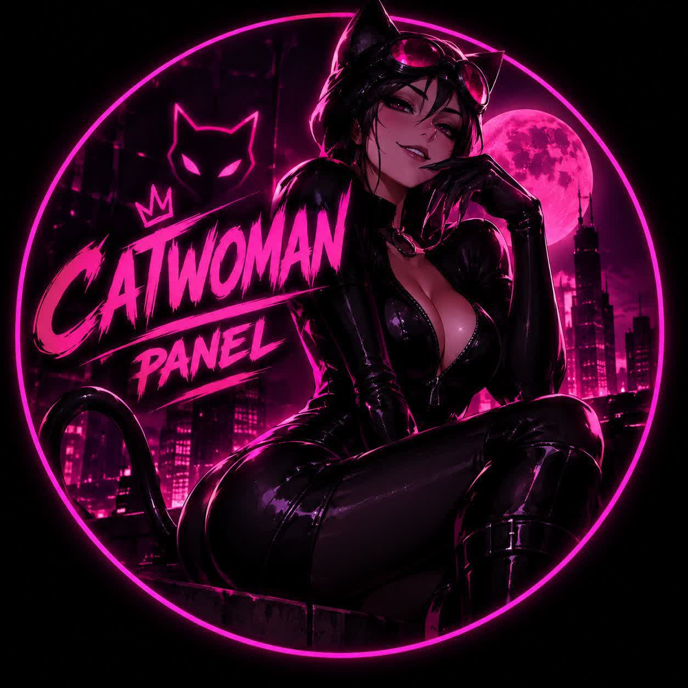
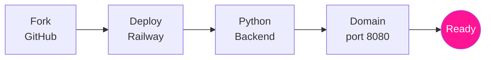

<div align="center">


<br><br>

<a href="https://t.me/Catwoman_ZaHra"></a>

<h1>Catwoman Panel</h1>

<p><b>پنل ساخت کانفیگ رایگان، سریع و متن‌باز بر پایه‌ی پایتون</b><br>
یک سرویس کامل: پنل و هسته‌ی قدرتمند Xray، با اجرای مستقیم روی Railway</p>

<a href="https://t.me/Catwoman_ZaHra"></a>


<br>


<br><br>

<a href="../../fork"></a>
<a href="https://railway.app/new"></a>

<br><br>

<a href="#intro"><b>معرفی</b></a> &nbsp;·&nbsp;
<a href="#install"><b>نصب</b></a> &nbsp;·&nbsp;
<a href="#protocols"><b>پروتکل‌ها</b></a> &nbsp;·&nbsp;
<a href="#features"><b>امکانات</b></a> &nbsp;·&nbsp;
<a href="#support"><b>پشتیبانی</b></a>

</div>

<br>

> [!NOTE]
> **Catwoman Panel** کاملاً رایگانه. ریپو رو Fork کن، روی Railway بساز و در کمتر از ۲ دقیقه پنل ساخت کانفیگ خودت رو تحویل بگیر. بدون VPS، بدون ترمینال، بدون تنظیم دستی.

<br>

> [!IMPORTANT]
> **چرا پایتون؟** بک‌اند این پروژه به صورت کامل با پایتون نوشته شده که کمترین مصرف منابع را روی سرورهای Railway دارد و بهینه‌ترین ارتباط را با هسته Xray برقرار می‌کند.

<br>

<div align="center">

| 🐍<br>**پایتون بیس** | ⚡<br>**هسته‌ی Xray** | 🛡️<br>**۳ پروتکل** | 🚂<br>**اجرا در ریلوی** | 🚀<br>**نصب یک‌کلیکی** |
|:---:|:---:|:---:|:---:|:---:|
| سبک و سریع | VLESS, Trojan, VMess | کاملاً رایگان | بدون نیاز به VPS | بدون تنظیمات دستی |

</div>

<br>

<a id="intro"></a>
## 🚀 شروع سریع و معماری



<br>

<a id="features"></a>
## ✨ امکانات

<table>
<tr>
<td width="50%" valign="top">

### 🚂 نصب بدون دردسر
- Fork و Deploy، بدون ویرایش حتی یک فایل
- بک‌اند پایتون و هسته‌ی Xray در **یک سرویس**
- بدون نیاز به VPS یا نصب ابزارهای جانبی
- همه چیز روی پورت `8080` تنظیم می‌شود

</td>
<td width="50%" valign="top">

### ⚙️ کانفیگ‌های حرفه‌ای
- پشتیبانی کامل از پروتکل **VLESS**
- پشتیبانی از پروتکل مخفی **Trojan**
- پشتیبانی از پروتکل **VMess**
- سازگاری کامل با تمام اپراتورها

</td>
</tr>
<tr>
<td valign="top">

### 🐍 بک‌اند قدرتمند پایتون
- کدنویسی بهینه و بسیار سبک
- مصرف بسیار پایین رم (RAM) در Railway
- اجرای دستورات هسته بدون هیچ تاخیر (Delay)
- راه‌اندازی سریع در کمتر از چند ثانیه

</td>
<td valign="top">

### 🔒 امنیت و اتصال
- مسیرهای ایمن و کانفیگ‌های قوی
- عدم نیاز به ثبت اطلاعات شخصی
- پنهان ماندن آی‌پی اصلی سرور
- سازگار با V2Box، v2rayNG و Hiddify

</td>
</tr>
</table>

<br>

<a id="install"></a>
## 🛠️ آموزش نصب قدم به قدم

> [!TIP]
> زمان نصب حدود **۱ تا ۲ دقیقه** است. فقط یک اکانت [GitHub](https://github.com) و یک اکانت [Railway](https://railway.app) لازم داری.

<details open>
<summary><b>مرحله‌ی ۱ &nbsp;·&nbsp; Fork کردن ریپو</b></summary>

<br>

1. بالای همین صفحه روی **Fork** بزن.
2. اسم ریپو رو هر چی خواستی بذار و **Create fork** رو بزن.
3. حالا یک نسخه از پروژه توی اکانت خودت داری. هیچ فایلی رو لازم نیست تغییر بدی.

</details>

<details open>
<summary><b>مرحله‌ی ۲ &nbsp;·&nbsp; ساخت سرویس روی Railway</b></summary>

<br>

1. وارد [Railway](https://railway.app) شو و بزن **New Project**.
2. گزینه‌ی **Deploy from GitHub repo** رو انتخاب کن و ریپوی Fork شده‌ی خودت رو بزن.
3. Railway خودش شروع به ساختن (Build) می‌کنه.

</details>

<details open>
<summary><b>مرحله‌ی ۳ &nbsp;·&nbsp; دامنه و پورت (مهم)</b></summary>

<br>

1. در پنل ریلوی برو به بخش **Settings ← Networking**.
2. بزن **Generate Domain** تا یک دامنه‌ی رایگان بهت بده.
3. پورت را دقیقاً روی عدد زیر تنظیم کن:

```text
8080
```

</details>

<details open>
<summary><b>مرحله‌ی ۴ &nbsp;·&nbsp; تبریک! پنل آماده است</b></summary>

<br>

اکنون می‌توانید آدرس دامنه‌ای که Railway به شما داده است را باز کنید و از ساخت کانفیگ‌های خود لذت ببرید!

</details>

<br>

<a id="protocols"></a>
## 🌍 پروتکل‌ها و اپلیکیشن‌ها

| پروتکل | وضعیت | توضیحات کاربردی |
|---|:---:|---|
| **VLESS** | 🟢 | سبک‌ترین پروتکل، بدون نیاز به رمزنگاری اضافه، مناسب برای دور زدن فیلترینگ مدرن. |
| **Trojan** | 🟢 | مخفی‌سازی ترافیک به شکل ترافیک استاندارد وب (HTTPS)، بسیار مقاوم. |
| **VMess** | 🟢 | پروتکل کلاسیک، سازگار با اکثر کلاینت‌های قدیمی و جدید. |

**اپ‌های پشتیبانی‌شده:**
- اندروید: `v2rayNG` · `V2Box` · `Hiddify` · `NekoBox`
- آی‌او‌اس (iOS): `V2Box` · `Streisand` · `Foxray`
- ویندوز: `v2rayN` · `NekoRay`

<br>

<a id="support"></a>
## 💬 پشتیبانی و کانال رسمی

<div align="center">

<a href="https://t.me/Catwoman_ZaHra"></a>

<br><br>

آپدیت‌ها، رفع مشکلات و پشتیبانی مستقیم از طریق تلگرام<br>
**[Catwoman_ZaHra](https://t.me/Catwoman_ZaHra)**

اگه این پروژه به کارت اومد، با یک **Star ⭐** اون بالا ازم حمایت کن.

</div>

<br>

## ⚖️ مجوز و قدردانی

- استفاده و نصب این پروژه **رایگانه**.
- این پروژه با پایتون و استفاده از هسته‌ی قدرتمند [Xray-core](https://github.com/XTLS/Xray-core) توسعه داده شده است.

<br>

<div align="center">

<sub><b>Catwoman Panel</b> · طراحی شده با 🩷 برای اینترنت آزاد</sub>


</div>